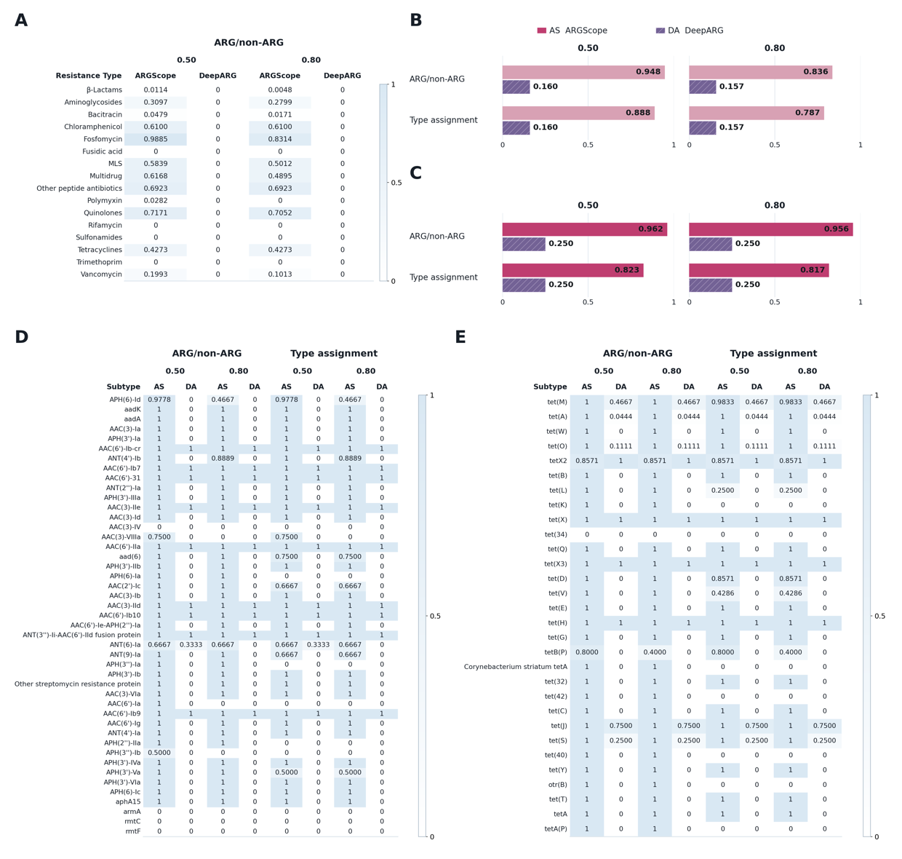

# Figure 6 — Resistance-type and subtype holdouts

This directory reproduces Figure 6 from the audited results on matched full-length protein sequences. The figure compares **ARGScope** (protein model) and **DeepARG** at score thresholds of 0.50 and 0.80.



## Reproduce the figure

From the repository root, with Python 3.10 or later:

```sh
python -m pip install -r benchmarks/novel_gene/requirements.txt
python benchmarks/novel_gene/plot_figure6.py --output Figure_6.pdf
```

Use an output filename ending in `.svg` or `.png` for those formats. The script calculates the plotted rates from the integer counts. It checks the result coverage and the pooled subtype counts before rendering. Reproduction uses the exported result table and requires no model downloads or sequence inputs.

## Files

| File | Contents |
| --- | --- |
| [`figure6_results.csv`](figure6_results.csv) | 372 rows containing the panel, paper row order, fold or group, model, threshold, support, confusion counts, and underlying rates. |
| [`folds.csv`](folds.csv) | The 91 folds, their held-out labels, and train, validation and test counts. The final column fingerprints the source split records. |
| [`split_membership.csv.gz`](split_membership.csv.gz) | 24,874 unique records, with one column per fold. Each record key is the SHA-256 of its original, case-sensitive UTF-8 sequence identifier. `true_ARG` is the original binary label. `T`, `V`, `E` and `.` denote training, validation, test and unassigned, respectively. |
| [`audit.json`](audit.json) | SHA-256 hashes of the source workbooks, final run audits, and exported files, plus coverage and paper-value checks. |

Split membership represents record assignments before method-specific filtering or alignment. It identifies the evaluation partitions. Replotting the figure uses the results CSV. Retraining also requires the original sequence inputs and training artifacts.

ARGScope used fold-specific training for the resistance-type holdouts. In the subtype holdouts, the upstream representation was kept fixed and the downstream models were retrained per fold. The subtype manifest records the downstream training, validation and test partitions.

## Panels and metric definitions

- **A** shows one fold per resistance type across 16 types. Each fold held out the entire positive class and evaluated ARG detection. Across the folds there were 11,277 unique held-out ARG records.
- **B and D** cover 45 aminoglycoside subtype folds and 268 held-out ARG records. **C and E** cover 30 tetracycline subtype folds and 344 held-out ARG records. Each fold held out one subtype while retaining other subtypes of its resistance type. Panels B and C pool the underlying counts across folds. Panels D and E show individual folds in paper order.
- **ARG/non-ARG** is ARG detection sensitivity, calculated as true positives divided by all held-out ARGs. **Type assignment** is the fraction of held-out ARGs both detected and assigned their true resistance type. Type assignment is defined for the subtype folds in this figure. Non-ARG specificity is included in the CSV for auditing. Non-ARG records may recur across folds.
- ARGScope uses its binary ARG probability. DeepARG uses the highest class confidence among trained classes supported by a qualifying alignment. A score at or above the specified threshold counts as detection. The two scores come from different model outputs.
